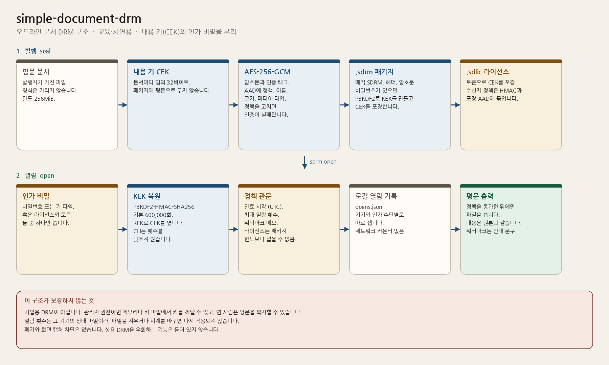

# simple-document-drm

정보관리기술사 포트폴리오 — 오프라인 문서 암호화와 인가.

최규선. 문서를 AES-256-GCM 패키지로 포장하고, 비밀번호 또는 라이선스 파일과 토큰이 있는 경우에만 열게 하는 교육용 CLI입니다. 네트워크 라이선스 서버는 없습니다.

이 저장소는 기밀성, 키 분리, 정책의 암호학적 결합을 한 번에 보여 주기 위한 시연입니다. 기업용 DRM 제품이 아니고, 상용 DRM을 분석하거나 우회하는 도구도 아닙니다.

## 무엇을 보여 주는가

발행자는 문서마다 임의의 내용 키(CEK)를 만들고, 그 키로 파일 바이트를 암호화합니다. CEK는 패키지에 그대로 두지 않습니다. 소유자 비밀번호에서 만든 키 암호화 키(KEK), 또는 수신자 토큰에서 만든 KEK로 감쌉니다.

만료 시각, 최대 열람 횟수, 워터마크 메모, 파일 이름, 크기는 암호문의 연관 데이터(AAD)에 들어갑니다. 헤더에서 정책만 고치면 복호화 인증이 실패합니다. 라이선스 파일은 같은 정책을 HMAC-SHA256으로도 묶습니다.

열람 횟수는 그 기기의 JSON 파일에 남습니다. 서버로 모으지 않습니다. 그래서 이 횟수는 기술적 통제의 데모이지, 조직 전체가 공유하는 관리적 통제가 아닙니다.

## 한계

정직하게 적습니다.

- 기업용 DRM이 아닙니다. 수신자 화면 캡처 차단, 프린터 제어, 신원 증명 연동, 라이선스 폐기가 없습니다.
- 키를 푸는 과정은 수신자 컴퓨터에서 일어납니다. 관리자 권한으로 프로세스 메모리나 키 파일을 볼 수 있는 사람은 키를 꺼낼 수 있습니다. 이 저장소는 그 방법을 설명하지 않습니다.
- 한 번 평문을 받은 사람은 그 파일을 복사할 수 있습니다. 오프라인 도구는 그 복사를 막지 못합니다.
- 최대 열람 횟수는 `opens.json`에만 기록됩니다. 기기마다 따로 세고, 인가 수단(비밀번호 / 라이선스)마다 따로 셉니다. 파일을 지우면 그 기기의 횟수는 처음부터 다시 셉니다. 시스템 시계를 되돌려 만료를 피하는 것도 이 버전의 범위 밖입니다.
- 워터마크는 열 때 보여주는 메모입니다. PDF나 이미지 픽셀에 보이지 않는 표를 심지 않습니다. 저장되는 파일 바이트는 원본과 같습니다.
- 라이선스를 가진 사람이 내용을 읽을 수 있다는 사실은, 그 사람이 내용 키를 잠시 갖게 된다는 뜻입니다. `grant`는 그 길을 열어 두지 않고, 패키지에 넣어 둔 소유자 비밀번호로만 추가 라이선스를 발급합니다.
- 품질은 교육·시연용입니다. 제3자의 상용 DRM 형식과는 무관합니다.

## 아키텍처



발행은 왼쪽에서 오른쪽으로 흐릅니다. 평문에서 CEK를 만들고, AES-256-GCM으로 암호문을 만든 뒤, `.sdrm` 패키지에 넣습니다. 비밀번호가 있으면 패키지 안에 CEK 포장이 들어가고, 수신자가 있으면 `.sdlic` 라이선스에 따로 포장합니다.

열람은 비밀로 KEK를 복원하고, CEK를 연 다음, 만료와 횟수와 워터마크를 확인합니다. 통과한 뒤에만 평문 파일을 쓰고 열람 횟수를 올립니다.

도형을 다시 그리려면 NanumGothic과 Pillow가 필요합니다.

```bash
python docs/render_architecture.py
```

## 요구 사항

- Python 3.11 이상
- [cryptography](https://cryptography.io/) 44 이상

## 설치와 테스트

```bash
python3 -m venv .venv
source .venv/bin/activate
pip install -e ".[dev]"
pytest
```

개발 의존성은 pytest입니다. 설치 후에는 `sdrm` 또는 `python -m simple_document_drm`으로 실행합니다. CLI 문장은 한국어입니다.

## 사용법

키 파일은 쉘 기록에 비밀이 남지 않게 할 때 씁니다. 권한은 소유자만 읽게 둡니다.

```bash
umask 077
printf '%s\n' 'demo-passphrase' > owner.key
printf '%s\n' '2026년 기밀 메모' > memo.txt

sdrm encrypt memo.txt -o memo.sdrm \
  --password-file owner.key \
  --expires 2026-12-31 \
  --max-opens 3 \
  --watermark '사외반출 금지' \
  --subject '기획팀'

sdrm inspect memo.sdrm
sdrm open memo.sdrm -o memo.out.txt --password-file owner.key
```

`YYYY-MM-DD`는 그 UTC 날짜가 끝날 때 만료됩니다. 저장 값은 다음 날 `00:00:00Z`이고, 그 시각부터 열 수 없습니다. 시간대가 있는 시각은 `2026-12-31T15:00:00Z`처럼 적습니다.

비밀번호 대신 라이선스만 만들 수도 있습니다. 이 경우 라이선스와 토큰을 잃으면 복구할 수 없습니다. 소유자 비밀번호를 같이 두는 쪽을 권합니다.

```bash
sdrm token > kim.token
sdrm grant memo.sdrm -o kim.sdlic \
  --password-file owner.key \
  --token-file kim.token \
  --subject kim \
  --max-opens 1 \
  --watermark '김대리'

sdrm open memo.sdrm -o memo.kim.txt \
  --license kim.sdlic \
  --token-file kim.token
```

`grant`의 만료와 횟수는 패키지 한도보다 느슨할 수 없습니다. 생략하면 패키지 값을 그대로 받습니다. 워터마크는 패키지 메모에 더해져 표시됩니다.

열람 기록의 기본 경로는 `~/.local/share/simple-document-drm/opens.json`입니다. `--state`로 바꿀 수 있습니다.

```bash
sdrm state
sdrm inspect-license kim.sdlic --token-file kim.token
```

`inspect`와 `inspect-license`는 포장된 내용 키를 출력하지 않습니다. 복호화된 바이트는 `--output` 파일로만 나가며, 터미널에는 메타데이터만 나옵니다.

## 명령

| 명령 | 역할 |
| --- | --- |
| `sdrm encrypt` | 평문을 `.sdrm`으로 포장합니다. `--license-out`을 주면 첫 라이선스도 같이 만듭니다. |
| `sdrm open` | 비밀번호 또는 라이선스로 열고, 정책을 통과하면 평문을 씁니다. |
| `sdrm grant` | 소유자 비밀번호로 추가 `.sdlic`을 발급합니다. |
| `sdrm inspect` | 패키지 헤더를 봅니다. |
| `sdrm inspect-license` | 라이선스 메타데이터를 봅니다. 토큰을 주면 MAC을 확인합니다. |
| `sdrm state` | 로컬 열람 기록을 봅니다. |
| `sdrm token` | 새 토큰을 한 줄로 출력합니다. |

공통 플래그 `--force`는 이미 있는 출력 파일을 덮어씁니다. `--json`은 사람용 문장 대신 JSON을 출력합니다.

## 정책

- 만료 시각이 지났으면 파일을 쓰지 않고 횟수도 올리지 않습니다.
- 횟수는 성공한 열람만 올립니다. 비밀번호가 틀리거나 암호문 인증이 실패하면 올리지 않습니다.
- 패키지 한도와 라이선스 한도가 둘 다 있으면 더 이른 만료, 더 작은 횟수를 적용합니다.
- 횟수 키는 `문서ID|password` 또는 `문서ID|license:라이선스ID`입니다.
- 상태 파일이 깨져 있으면 열람을 거절합니다. 자동으로 초기화하지 않습니다.

## 파일 형식

`.sdrm`은 바이너리입니다.

```text
SDRM | version 1 | header length (4바이트, 빅엔디언) | UTF-8 JSON 헤더 | AES-GCM 암호문(태그 포함)
```

헤더의 비밀이 아닌 필드만 `inspect`에 나옵니다. 인증되는 필드는 문서 ID, 파일 이름, 미디어 타입, 평문 크기, 정책입니다. 생성 시각은 헤더에만 있고 인증 데이터에는 넣지 않습니다.

`.sdlic`은 JSON입니다. `wrap.wrapped_cek`가 토큰으로 감싼 CEK이고, `mac`은 그 바깥 필드의 HMAC입니다. 정책을 고친 뒤 MAC만 다시 계산해도, 포장 당시의 AAD와 다르면 키 복원이 실패합니다.

KDF는 PBKDF2-HMAC-SHA256이고 기본 반복 횟수는 600,000입니다. CLI에는 이 횟수를 낮추는 플래그가 없습니다. 패키지에 기록된 횟수는 `inspect`에서 볼 수 있습니다.

출력 패키지, 라이선스, 평문, 열람 기록의 파일 권한은 `0600`입니다.

## 종료 코드

| 코드 | 의미 |
| --- | --- |
| 0 | 성공 |
| 2 | 사용법. 인자가 빠졌거나 출력 파일이 이미 있습니다. |
| 3 | 인증 실패. 비밀번호, 토큰, 또는 키 포장이 거부되었습니다. |
| 4 | 정책 거부. 만료, 횟수 초과, 또는 패키지보다 느슨한 라이선스입니다. |
| 5 | 무결성 실패. 암호문이나 인증된 메타데이터가 바뀌었습니다. |
| 6 | 형식 오류. 패키지, 라이선스, 열람 기록을 해석할 수 없습니다. |
| 1 | 그 밖의 오류 |

## 프로젝트 구성

```text
src/simple_document_drm/   CLI, 암호, 패키지, 라이선스, 정책, 열람 기록
tests/                     암호·정책·패키지·라이선스·CLI 테스트
docs/architecture.png      구조도
docs/render_architecture.py
```

## 라이선스

MIT. `LICENSE`를 보십시오.

---

## English

Educational offline document DRM for a Korean information-management portfolio (정보관리기술사). It seals a file into an `.sdrm` package with AES-256-GCM. A password, or a license file plus a token, unwraps the content key. There is no network license server.

This is a demo of envelope encryption and local policy checks. It is not an enterprise DRM product, and it does not analyse or bypass commercial DRM.

### What it demonstrates

A random 32-byte content key encrypts the file. A key-encryption key derived with PBKDF2-HMAC-SHA256 (600,000 iterations) wraps that content key. The password wrap lives in the package. A recipient wrap lives in a separate `.sdlic` file and is covered by HMAC-SHA256.

Expiry, open cap, watermark note, filename, media type, and size are AES-GCM associated data. Editing the policy in the header fails authentication. The open cap is stored on the machine that opened the file, not on a server.

### Limitations

- Not enterprise DRM. No screen-capture block, no print control, no revocation, no identity provider.
- Unwrapping happens on the recipient's computer. A person with administrator access can take a key from process memory or from a key file. This repository does not explain how.
- Anyone who receives plaintext can copy it.
- The open count is per machine and per authority (owner password or a specific license). Deleting `opens.json` starts a new count on that machine. Turning the clock back is outside what this version can stop.
- The watermark is a note printed at open time. It is not embedded in the file bytes. The written file matches the original.
- `grant` issues a further license only with the owner password stored in the package. It does not accept a recipient license as the authority to mint another one.
- Demo quality.

### Install and test

```bash
python3 -m venv .venv
source .venv/bin/activate
pip install -e ".[dev]"
pytest
sdrm --help
```

CLI messages are Korean. `python -m simple_document_drm` is the same entry point.

### Use

```bash
umask 077
printf '%s\n' 'demo-passphrase' > owner.key
printf '%s\n' 'confidential note' > memo.txt

sdrm encrypt memo.txt -o memo.sdrm \
  --password-file owner.key \
  --expires 2026-12-31 \
  --max-opens 3 \
  --watermark 'do not circulate' \
  --subject planning

sdrm inspect memo.sdrm
sdrm open memo.sdrm -o memo.out.txt --password-file owner.key

sdrm token > kim.token
sdrm grant memo.sdrm -o kim.sdlic \
  --password-file owner.key \
  --token-file kim.token \
  --subject kim \
  --max-opens 1

sdrm open memo.sdrm -o memo.kim.txt \
  --license kim.sdlic \
  --token-file kim.token
```

A date `YYYY-MM-DD` is valid through that UTC calendar day. It is stored as the next midnight, and open fails when `now >= expires_at`. A full timestamp needs `Z` or a numeric offset.

`--password` and `--token` also work, but they can land in shell history. Prefer a mode `0600` key file. Do not pass a password and a license to `open` together.

`sdrm grant` cannot set a later expiry or a higher open cap than the package. Omit either flag to inherit the package value. The default open-count file is `~/.local/share/simple-document-drm/opens.json`. Override it with `--state`.

`inspect` never prints the wrapped content key. Plaintext is written only to `--output`.

### Commands and exit codes

`encrypt`, `open`, `grant`, `inspect`, `inspect-license`, `state`, `token`.

`--force` overwrites an existing output. `--json` prints metadata as JSON.

| Code | Meaning |
| --- | --- |
| 0 | Success |
| 2 | Usage, including refusing to overwrite without `--force` |
| 3 | Authentication failed |
| 4 | Policy rejected the open, or a license is looser than the package |
| 5 | Integrity check failed |
| 6 | Package, license, or state file is malformed |
| 1 | Other errors |

### Package layout

`.sdrm` is `SDRM`, version byte `1`, a 4-byte big-endian header length, a UTF-8 JSON header, then the AES-GCM ciphertext including its tag. Authenticated fields are document id, filename, media type, plaintext size, and policy.

`.sdlic` is JSON. The token-wrapped content key is `wrap.wrapped_cek`. The HMAC covers the license body. Re-signing the HMAC after an edit still fails unwrapping, because the policy is also associated data on the wrapped key.

The architecture drawing is `docs/architecture.png`. License: MIT.
